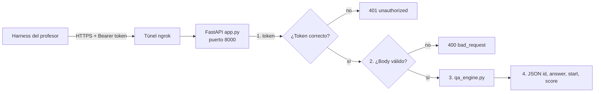

# Cómo funciona el servicio de QA extractivo

## 1. La idea en una frase

Recibimos un **párrafo** (context) y una **pregunta**; el modelo marca **dónde empieza y dónde termina** la respuesta dentro del párrafo, o decide que **la respuesta no está** (`null`). No genera texto nuevo: solo señala un pedazo del texto original. Por eso se llama QA *extractivo*.

```text
context:  "The Lempa River ... flowing about 422 km from Guatemala ..."
question: "How long is the Lempa River?"
                                  ▲start      ▲end
answer:   "about 422 km"   start = 61
```

## 2. Vista general



## 3. El modelo: un encoder Transformer

Usamos **DistilBERT**, una versión reducida de BERT (6 capas en vez de 12, 66 M parámetros). Es un **encoder**: lee toda la entrada a la vez y produce un vector por cada token, que "entiende" su contexto en ambas direcciones (atención bidireccional).

El modelo pre-entrenado sabe inglés, pero no sabe responder preguntas. El **fine-tuning** le agrega una capa lineal muy pequeña encima que, para cada token, produce dos números:

- `start_logit`: qué tan probable es que la respuesta **empiece** en ese token.
- `end_logit`: qué tan probable es que **termine** ahí.

La entrada que ve el modelo tiene esta forma:

```text
[CLS] pregunta [SEP] párrafo [SEP]
```

El token especial **`[CLS]`** (posición 0) se usa como "no hay respuesta": en SQuAD 2.0, a las preguntas sin respuesta se les enseña que el inicio y el final son `[CLS]`.

## 4. Entrenamiento (`train.py`)

1. **Datos:** SQuAD 2.0 (≈130 k preguntas, ≈1/3 sin respuesta), descargado con la librería `datasets`.
2. **Preprocesamiento (`make_train_features`):** cada pregunta+párrafo se tokeniza. Si el párrafo es más largo que 384 tokens, se parte en **ventanas** que se solapan 128 tokens. Para cada ventana se calcula en qué token empieza y termina la respuesta usando el `offset_mapping` (la tabla que dice a qué caracteres corresponde cada token). Si la respuesta no está en esa ventana, o la pregunta no tiene respuesta, la etiqueta es `[CLS]`.
3. **Fine-tuning:** `Trainer` de Hugging Face minimiza la entropía cruzada de la posición de inicio + la de fin. Hiperparámetros: learning rate 3e-5 con warmup del 10 % y decaimiento lineal, batch 16, 2 épocas.
4. **Curva de pérdida:** se registra la pérdida de entrenamiento cada 50 pasos y la de validación cada 500 → `logs/loss.png`.
5. **Umbral de null:** se calcula al final (sección 6).

## 5. Inferencia (`qa_engine.py`), paso a paso

1. **Tokenizar en ventanas** (`_encode`): misma configuración que en el entrenamiento (384 / 128). Un contexto de 5000 caracteres produce ~4–5 ventanas. Así **no se pierde información** de contextos largos (como `sample-05`, de más de 512 tokens).
2. **Pasar todas las ventanas juntas** por el modelo (`_logits`) en modo `inference_mode` (sin gradientes, más rápido).
3. **Buscar el mejor span** (`raw_scores`): en cada ventana se toman los 20 mejores inicios y los 20 mejores finales, y se descartan combinaciones inválidas:
   - que caigan en la pregunta o en tokens especiales,
   - que el final esté antes del inicio,
   - que midan más de 30 tokens.
   
   Puntaje del span = `start_logit + end_logit`. Nos quedamos con el mejor de todas las ventanas.
4. **Puntaje de "no respuesta"**: `start_logit[CLS] + end_logit[CLS]`, tomando el mínimo entre ventanas.
5. **Decisión** (`decide`):

   ```text
   si (null_score − best_span_score) > umbral  →  answer = null
   si no                                        →  answer = el span
   ```

6. **Convertir tokens a caracteres:** con `offset_mapping` se obtiene `start` (posición en caracteres) y se corta el texto **directamente del contexto original**: `answer = context[start:end]`. Eso garantiza la regla del contrato `context[start:start+len(answer)] == answer`, aunque el tokenizer pase todo a minúsculas.
7. **Score** en [0, 1]: una sigmoide del margen respecto al umbral. Indica la confianza en la salida (span o null). No se califica.

## 6. Cómo se elige el umbral

Si siempre respondemos un span, fallamos todas las preguntas sin respuesta (~25 % del examen). Si somos demasiado estrictos, devolvemos `null` aunque la respuesta esté.

En `tune_threshold` (dentro de `train.py`), para 2000 preguntas de validación se calcula una vez `diff = null_score − best_span_score`. Luego se prueban todos los umbrales posibles y se elige el que da **mayor F1**. El valor queda guardado en `model/qa_meta.json` y la API lo lee al arrancar.

Detalle importante: el umbral se calcula **con el mismo código que usa la API** (`QAEngine.raw_scores`), así que no hay diferencias entre lo que medimos y lo que servimos.

- **Umbral muy bajo** → demasiados `null` → perdemos preguntas con respuesta.
- **Umbral muy alto** → nunca `null` → fallamos las preguntas sin respuesta.

## 7. La API (`app.py`)

| Endpoint | Protegido | Qué hace |
|---|---|---|
| `GET /health` | No | `200 {"status":"ok"}` si el modelo cargó, `503 {"status":"loading"}` mientras carga |
| `GET /info` | Sí | Equipo, modelo base, número de parámetros, 384, 128 |
| `POST /predict` | Sí | `{"id","answer","start","score"}` |

**Carga del modelo:** al arrancar, un hilo en segundo plano (`load_engine`) carga el modelo y hace una predicción de calentamiento. Mientras tanto el servidor ya responde `/health` con 503.

**Flujo de `/predict`:**

1. **Control de acceso primero**: sin token válido → 401, sin importar el body.
2. **Validación**: JSON válido, objeto, campos `id`, `context`, `question` presentes, tipos string, longitudes del contrato (1–64, 1–5000, 1–500), sin campos extra → si no, `400 {"error":"bad_request","detail":...}`.
3. **Inferencia** en un hilo aparte (`run_in_threadpool`) para no bloquear el servidor; un `Lock` hace que se procese una pregunta a la vez (latencia estable en CPU).
4. **Red de seguridad**: se verifica `context[start:start+len(answer)] == answer`. Si por algún motivo no se cumple, se devuelve `null` en vez de una respuesta inválida.
5. Cualquier excepción no prevista → `500 {"error":"internal_error"}`.

**Control de acceso:**

- El token se lee de la variable de entorno `QA_API_TOKEN`; **nunca está en el código** ni en git (`.env` está en `.gitignore`).
- La comparación es exacta y sensible a mayúsculas: el encabezado debe ser exactamente `Authorization: Bearer <token>`.
- Se usa `hmac.compare_digest`, que tarda lo mismo aunque el token sea casi correcto (evita ataques por tiempo).
- Si la variable no está definida, el servidor rechaza todo (*fail closed*).

## 8. El túnel

El servicio corre en la laptop (CPU). `ngrok http 8000` crea una URL pública HTTPS que reenvía las peticiones a `localhost:8000`. Como esa URL es pública, cualquiera podría llamar al servicio: por eso existe el token.

## 9. ¿Por qué no un decoder (GPT)?

Un decoder genera la respuesta palabra por palabra: es más lento en CPU (una pasada por cada token generado), puede generar texto que **no está literalmente** en el contexto (y entonces no hay `start` válido) y es más grande. El encoder hace **una sola pasada** y solo puede señalar texto existente, que es justo lo que pide el contrato. En el reporte (sección 8) se discute cuándo un decoder sí ayudaría: respuestas sí/no, respuestas que combinan dos partes del texto, contextos muy largos.

---

## 10. Preguntas típicas del Q&A (practíquenlas sin IA)

**¿Dónde se valida el token?**
En `app.py`, función `is_authorized`, llamada al inicio de `/info` y `/predict`. Lee `QA_API_TOKEN` del entorno y compara con `hmac.compare_digest` contra `"Bearer " + token`.

**¿Qué pasa si el contexto tiene más de 384 tokens?**
`_encode` lo parte en ventanas de 384 con solapamiento de 128 (`return_overflowing_tokens=True`, `stride=128`). Se evalúan todas y se toma el mejor span entre ventanas.

**¿Por qué el solapamiento (doc_stride)?**
Para que una respuesta que caería cortada en el borde de una ventana aparezca completa en la siguiente.

**¿Cómo obtienen `start` en caracteres?**
Con `offset_mapping`: para cada token el tokenizer guarda `(char_inicio, char_fin)` en el texto original. Tomamos el `char_inicio` del token inicial y el `char_fin` del token final.

**¿Cómo deciden devolver null?**
Comparan el puntaje de `[CLS]` con el del mejor span: si `null_score − best_span_score > umbral`, devuelven null. El umbral se eligió maximizando F1 en 2000 preguntas de validación.

**¿Qué pasa si llega un body sin `question`?**
`/predict` devuelve `400 {"error":"bad_request","detail":"field 'question' is required"}`.

**¿Por qué `/health` devuelve 503 al inicio?**
Porque el modelo se carga en un hilo aparte; el contrato dice que `ok` solo cuando ya puede responder `/predict`.

**¿Qué hace el `Lock`?**
Evita que dos inferencias compitan por los núcleos de la CPU al mismo tiempo; el harness manda las preguntas una a una, así que no perdemos nada.

**¿Por qué DistilBERT y no DeBERTa?**
DeBERTa-v3-base es más preciso pero ~3 veces más lento en CPU y más pesado; con 5 s por petición, túnel incluido, y 150 s para 50 preguntas, DistilBERT da margen de sobra. Además, la nota máxima se alcanza al igualar la referencia, que es DistilBERT.

**¿Cuántos parámetros tiene el modelo y de dónde sale el número de `/info`?**
`sum(p.numel() for p in model.parameters())` en `QAEngine.__init__` (≈66 M para DistilBERT).

**¿Qué mide `scripts/check_service.py`?**
Las 5 pruebas del enunciado, dos casos de error extra, la muestra pública con la regla `context[start:...] == answer`, EM/F1 y la latencia.
